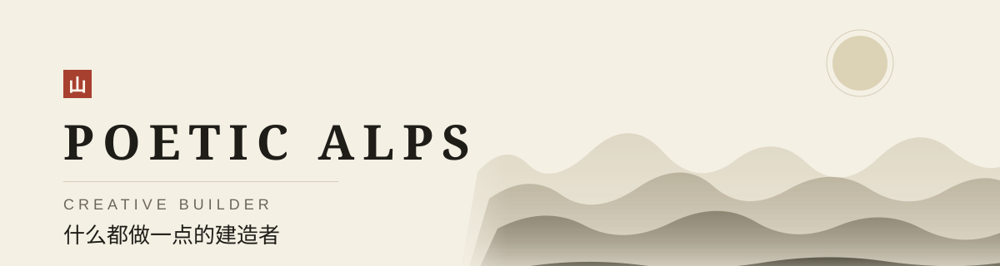
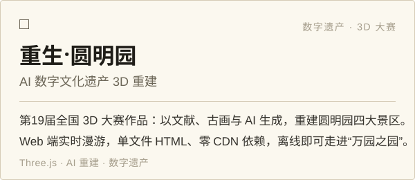
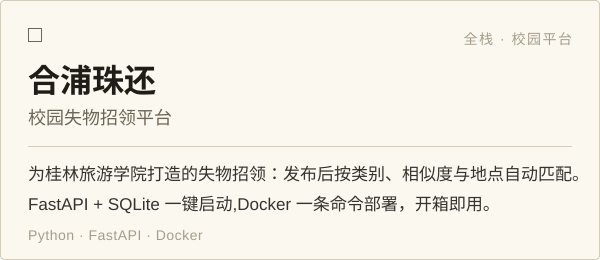
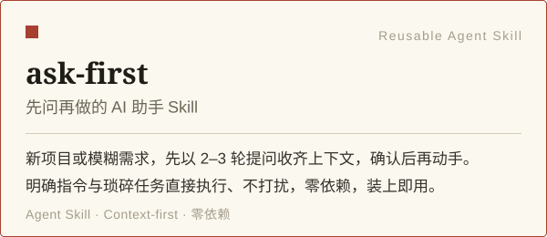
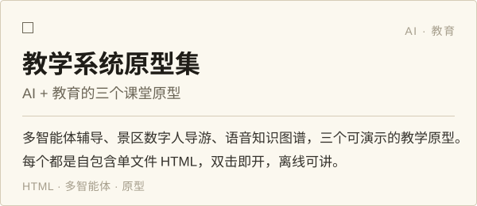
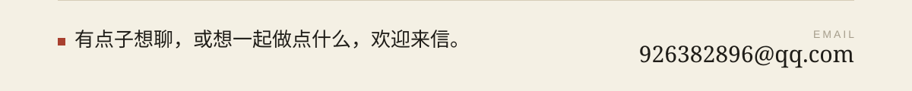

  <picture>
    <source media="(prefers-color-scheme: dark)" srcset="assets/banner-dark.svg">
    
  </picture>

  喜欢把课堂、文化遗产和小游戏的点子，做成能跑起来的东西。 
  Turning ideas for classrooms, heritage and little games into things that run.

<table>
  <tr>
    <td width="50%">
      <a href="https://github.com/PoeticAlps/--3d">
        <picture>
          <source media="(prefers-color-scheme: dark)" srcset="assets/card-yuanmingyuan-3d-dark.svg">
          
        </picture>
      </a>
    </td>
    <td width="50%">
      <a href="https://github.com/PoeticAlps/Ricardo">
        <picture>
          <source media="(prefers-color-scheme: dark)" srcset="assets/card-hepu-zhuhuan-dark.svg">
          
        </picture>
      </a>
    </td>
  </tr>
  <tr>
    <td width="50%">
      <a href="https://github.com/PoeticAlps/ask-first">
        <picture>
          <source media="(prefers-color-scheme: dark)" srcset="assets/card-ask-first-dark.svg">
          
        </picture>
      </a>
    </td>
    <td width="50%">
      <a href="https://github.com/PoeticAlps/agnes-learning-systems">
        <picture>
          <source media="(prefers-color-scheme: dark)" srcset="assets/card-agnes-learning-dark.svg">
          
        </picture>
      </a>
    </td>
  </tr>
</table>

  <picture>
    <source media="(prefers-color-scheme: dark)" srcset="assets/pacman/pacman-contribution-graph-dark.svg">
    
  </picture>

  <a href="mailto:926382896@qq.com">
    <picture>
      <source media="(prefers-color-scheme: dark)" srcset="assets/footer-dark.svg">
      
    </picture>
  </a>

  GitHub · <a href="https://github.com/PoeticAlps">github.com/PoeticAlps</a>

